<p align="center">
  
</p>

<p align="center">
  
  
  
  
</p>

---

##  Sobre o projeto

O **VivaBem** é uma aplicação web para academias, desenvolvida em **Laravel**. O sistema reúne o site institucional, com a apresentação das modalidades e o contato com a academia, e áreas restritas para **administradores, instrutores e alunos**.

---

##  Funcionalidades

**Site institucional**
- Páginas de início, sobre, blog, treinos e orçamento
- Catálogo de modalidades: musculação, treino de peso, aeróbico, lutas, natação e meditação
- Formulário de contato com registro no banco de dados e envio por e-mail

**Áreas restritas**
- Login de usuários
- Painel do administrador
- Painel do instrutor
- Painel do aluno

---

##  Identidade visual

| Cor | Hex | Uso |
|:---:|:---:|:---|
|  | `#48C9B0` | Cor principal (tema) |
|  | `#FFB539` | Destaque secundário |
|  | `#1C1C1C` | Títulos e fundos escuros |
|  | `#F3F3F3` | Fundos claros |

**Tipografia:** Poppins

---

##  Como executar

**Pré-requisitos:** PHP 8.0+, Composer e MySQL.

```bash
# Clonar o repositório
git clone https://github.com/GustavoHermogenes/academia.git
cd academia/vivaBem

# Instalar as dependências
composer install

# Configurar o ambiente
cp .env.example .env
php artisan key:generate
# Ajuste as credenciais do banco de dados e do e-mail no arquivo .env

# Criar as tabelas
php artisan migrate

# Iniciar o servidor
php artisan serve
```

A aplicação estará disponível em `http://localhost:8000`.

---

##  Autor

<p>
  <b>Gustavo Hermogenes</b> — Desenvolvedor Full Stack<br/><br/>
  <a href="https://github.com/GustavoHermogenes" target="_blank"></a>
  <a href="https://www.linkedin.com/in/gustavohermogenes/" target="_blank"></a>
</p>

<p align="center">
  
</p>
